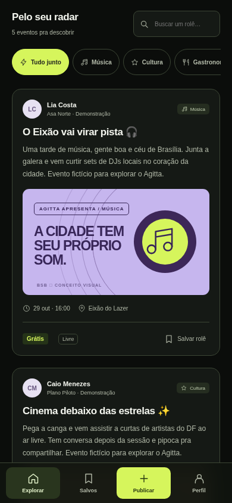
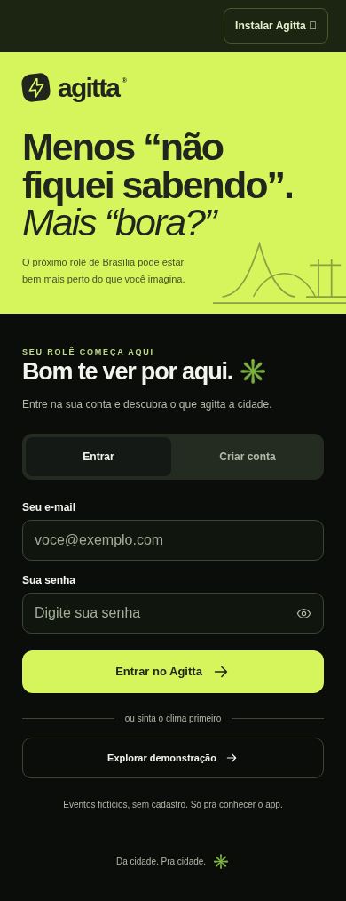
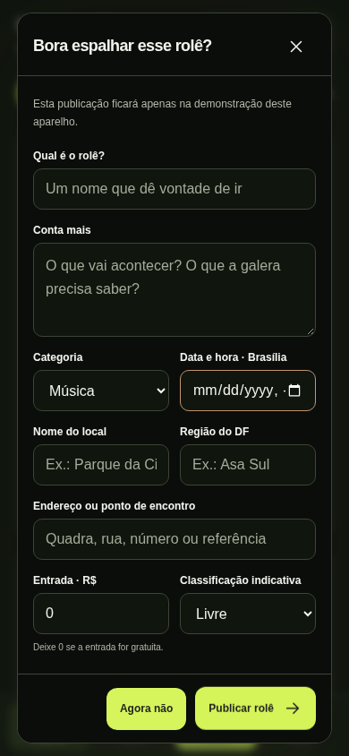

**Assim está o Agitta — prévia visual da versão 0.2.0**

Capturas reais do site renderizado no navegador em 28/10/2026, com o tema escuro do aparelho ativado. Os eventos exibidos pertencem à demonstração e são fictícios.

O tema acompanha o sistema e usa preto como padrão quando não há preferência clara disponível. A troca acontece sem recarregar a página.

No computador, o feed tem navegação lateral, destaque principal, busca, categorias e sugestões por região.

No celular, os cartões de eventos ficam em uma coluna e a navegação permanece na parte inferior. Esta captura mostra o feed depois de rolar a página.

A entrada reúne login, criação de conta e acesso à demonstração.

Para divulgar um rolê, o formulário reúne descrição, data, local, região, endereço, preço e classificação.

Quando o aparelho está no tema claro, a mesma interface acompanha essa preferência:

